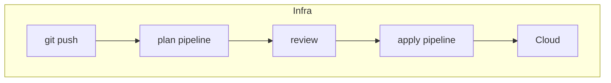
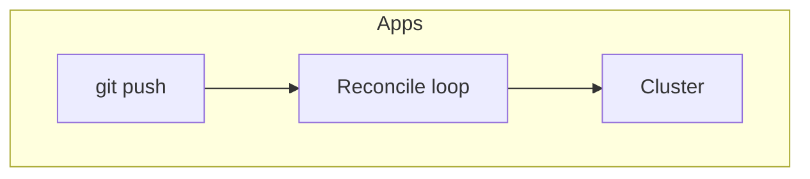
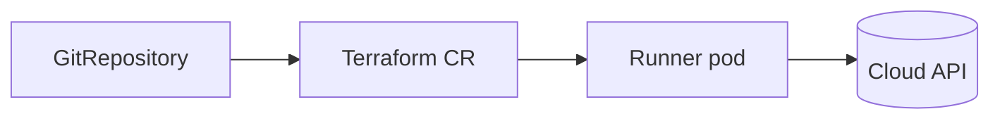
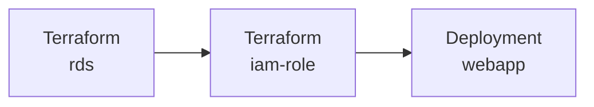

# Evolution, not revolution

Pushing Terraform into Kubernetes GitOps

<div class="pt-12 text-lg opacity-70">
Giovanni Toraldo · DevOps Engineer @ Hyland
</div>

<div class="pt-2 text-sm opacity-50">
<a href="https://www.containerday.it/">ContainerDay 2026</a>
</div>

<!--
Evolve what we already have, don't throw it away.
-->

---
layout: statement
---

# **Your apps:** `git push` → reconciled

<!--
- For apps, Flux watches Git and the cluster catches up on its own
-->

---
layout: statement
---

# **Your infra:** `git push` → plan pipeline → manual review → apply pipeline

<!--
- For infra, it's still a pipeline with a human in the loop
-->

---
layout: center
---

<div class="flex justify-center">



</div>

<div class="flex justify-center">



</div>

<div class="text-center text-4xl py-6">
Not a missing automation. <strong>Missing a shared one</strong>
</div>

<!--
- Both sides are already automated: a CI pipeline for infra, Flux for apps
- Often two different teams too: an infra team owns Terraform and the secrets store, a platform team owns the cluster, Flux, and External Secrets Operator
- ESO writing Terraform outputs into Secrets Manager already closes the technical gap for the secret, but it's a second system on its own poll interval, one that has no idea when the infra is actually ready
- The fracture isn't a missing script, it's two systems from two different eras of automation that were never taught to share a graph
-->

---
layout: statement
---

# ♻️ Don't rewrite. Run it in **Kubernetes**

<!--
- The instinct is: rewrite to cloud native, move to Crossplane
- That's the revolution. It throws away working modules and the team's Terraform experience
- The evolution: keep the HCL, move where it runs
-->

---
layout: center
---

# tofu-controller

A Flux controller that runs your Terraform



<!--
- It's a CRD plus a controller, part of the Flux ecosystem
- Points at the same Git source Flux already watches
- Runs terraform/tofu inside the cluster, on an interval, like any other reconciler
-->

---
layout: center
---

# Introducing Terraform Custom Resource

Point your existing stack, tofu-controller applies it.

```yaml {1-4|5-9|10-12|13-14|all}
apiVersion: infra.contrib.fluxcd.io/v1alpha2
kind: Terraform
metadata:
  name: rds
spec:
  path: ./root-modules/rds
  sourceRef:
    kind: GitRepository
    name: infra
  vars:
    - name: size
      value: small
  interval: 10m
  approvePlan: auto
```

<!--
A repo with reusable Terraform stacks (not plain modules), still a matter for infra teams.
-->

---
layout: statement
---

# 🔐 Outputs become **Secrets**

<!--
Terraform outputs land in a native Secret, no secrets manager in between.
-->

---
layout: two-cols-header
layoutClass: gap-8
---

# From state to Secret to Pod

::left::

<div class="text-sm opacity-60 pb-2">Terraform CR</div>

```yaml {1-3|1-7}
spec:
  writeOutputsToSecret:
    name: rds-output
    outputs:
      - endpoint
      - password
      - db_arn
```

::right::

<div class="text-sm opacity-60 pb-2">Deployment</div>

```yaml {none|1-14}
spec:
  containers:
    - name: webapp
      env:
        - name: DB_ENDPOINT
          valueFrom:
            secretKeyRef:
              name: rds-output
              key: endpoint
        - name: DB_PASSWORD
          valueFrom:
            secretKeyRef:
              name: rds-output
              key: password
```

<!--
Terraform outputs are written to a Kubernetes Secret, which can then be consumed by other resources like Deployments.
-->

---
layout: center
---

# One dependency graph



<!--
Single dependency graph, without polling an external system.
-->

---
layout: two-cols-header
layoutClass: gap-8
---

# `dependsOn`, both ways

::left::

<div class="text-sm opacity-60 pb-2">Terraform after Terraform</div>

```yaml {1-7|8-12|8-12|all}
apiVersion: infra.contrib.fluxcd.io/v1alpha2
kind: Terraform
metadata:
  name: iam-role
spec:
  dependsOn:
    - name: rds
  varsFrom:
    - kind: Secret
      name: rds-output
      varsKeys:
        - db_arn
```

::right::

<div class="text-sm opacity-60 pb-2">App after infra</div>

```yaml {1-4|5-8|all}{at:2}
apiVersion: kustomize.toolkit.fluxcd.io/v1
kind: Kustomization
metadata:
  name: webapp
spec:
  dependsOn:
    - name: infra
  wait: true
```

<!--
`dependsOn` declares explicit dependencies between resources
-->

---
layout: statement
---

# 🚦 Where did the **approval gate** go?

<!--
We can still approve a plan.
-->

---

# Merge, plan, review, approve

```yaml
spec:
  storeReadablePlan: human
  approvePlan: ""
```

<v-click>

```yaml
apiVersion: v1
kind: ConfigMap
metadata:
  name: tfplan-default-rds
  annotations:
    savedPlan: plan-main-b8e362c206
data:
  tfplan: |
    # aws_db_instance.rds will be created
    + resource "aws_db_instance" "rds" {
        + identifier = "rds"
        ...
      }
```

</v-click>

<v-click>

```yaml
spec:
  storeReadablePlan: human
  # plan-<branch>-<10 char git sha>, tied to the exact commit planned
  approvePlan: plan-main-b8e362c206
```

</v-click>

<!--
Plan is stored in a human-readable ConfigMap and can be approved via Git.
-->

---
layout: statement
---

# Humans love to click a console
# **What's on Git wins anyway**

<!--
Running Terraform in a loop gives drift detection for free.
-->

---
layout: center
---

# **⚠️ Where this gets harder**

<div class="text-2xl">

- Terraform state still required
- Cluster holds infrastructure credentials
- Debugging means watching pod logs
- Drift detection is costly for big stacks
- Still an alpha API, community maintained

</div>

<!--
Terraform state is stored as Kubernetes Secrets by default, but it can be configured to use an external backend for better durability and security. The blast radius grows, since the cluster holds infrastructure credentials.
-->

---
layout: statement
---

# One repo, one loop
# **One control plane**

<!--
- Apps and infra, reconciled the same way, by the same controller family
- Same HCL, now running where the rest of the cluster already runs
-->

---
layout: end
---

<h1 class="text-8xl">Thanks 🐟</h1>

<div class="flex flex-col gap-1 [&_a]:text-white [&_a]:opacity-70">

[github.com/gionn/tofu-controller-lightning-talk](https://github.com/gionn/tofu-controller-lightning-talk)

[flux-iac.github.io/tofu-controller](https://flux-iac.github.io/tofu-controller/)

Add me on LinkedIn: [linkedin.com/in/giovannitoraldo/](https://www.linkedin.com/in/giovannitoraldo/)

</div>

<!--
- Questions?
-->
